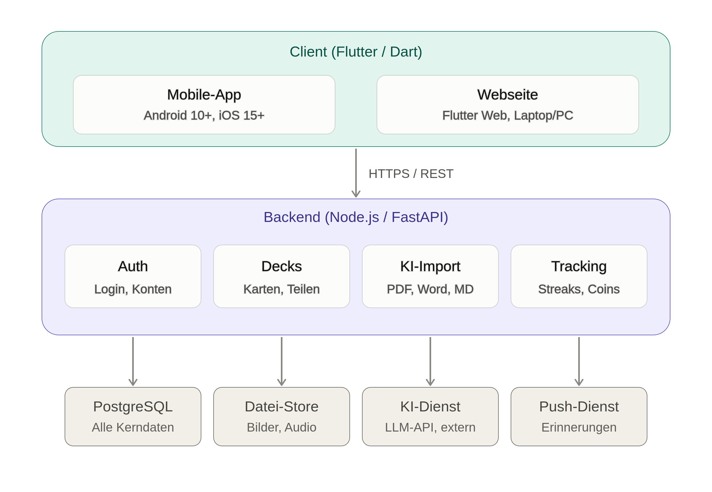

# Pflichtenheft - Mind Forge

| | |
|---|---|
| **Projekt** | Mind Forge – Karteikarten-Lernapp mit KI-Import und Lernspiel |
| **Team** | Luka Maric, Ibo Lawand, Edin Kurtic, Samed Elgit |
| **Version** | 1.0 |
| **Stand** | 12.10.2026 |

## 1. Pflichtenheft „Was mache ich“

### 1.1. Ausgangssituation

Die HTL Leonding hat ca. 1000 Schüler in mehreren Fachabteilungen. Schüler müssen laufend viel Lernstoff für Prüfungen aufbereiten und wiederholen – Karteikarten sind dafür eine bewährte, aber oft mühsame Methode.

### 1.2. Istzustand

Der Lernstoff liegt meist schon digital vor (PDF-Skripten, Word-Dokumente, Markdown-Mitschriften). Trotzdem schreiben viele Schüler ihre Karten von Hand oder tippen sie einzeln in eine Lern-App ab.

Marktführer sind:

- **Anki:** kostenlos und quelloffen, mit bewährtem Spaced-Repetition-Algorithmus. Die Oberfläche ist jedoch veraltet und für Einsteiger unübersichtlich, Gamification gibt es keine.
- **Quizlet:** einfach zu bedienen und weit verbreitet, aber Freemium. Kernfeatures wie KI-Import und Offline-Modus liegen hinter der Paywall.

| Funktion | Anki | Quizlet | Mind Forge |
|---|:---:|:---:|:---:|
| Karten aus Dokumenten per KI erzeugen | – | nur bezahlt | ✓ |
| Mehrere Lernmodi | eingeschränkt | ✓ | ✓ |
| Spaced Repetition | ✓ | nur bezahlt | ✓ |
| Lernspiel mit Spielmechanik | – | einfache Minispiele | ✓ |
| Lernstatistik und Streaks | ✓ | eingeschränkt | ✓ |
| Kernfunktionen kostenlos | ✓ | – | ✓ |
| Moderne, einsteigerfreundliche Oberfläche | – | ✓ | ✓ |

### 1.3. Problemstellung

- **Zeitaufwand:** Analoge Karten zu schreiben oder Karten einzeln abzutippen kostet Zeit, die dann beim eigentlichen Lernen fehlt.
- **Kein Import aus vorhandenem Material:** Aus einem fertigen Skript entsteht nicht automatisch ein Kartensatz.
- **Kosten:** Komfortable Tools verlangen für Kernfunktionen ein Abo; die Gratisversionen sind stark eingeschränkt.
- **Motivation:** Wiederholen wird schnell eintönig. Abgesehen von Streak-Zählern gibt es kaum Anreize, regelmäßig statt erst am Vorabend der Prüfung zu lernen.
- **Keine Zusammenarbeit:** Jeder Schüler bereitet denselben Stoff für sich allein auf, statt fertige Kartensätze mit dem Jahrgang zu teilen.

### 1.4. Aufgabenstellung

Es wird eine Lernapp entwickelt, mit der Schüler ihren Lernstoff in Karteikarten bringen – manuell oder per KI aus vorhandenen Dokumenten – und in verschiedenen Lernmodi sowie einem Lernspiel wiederholen. Die Kernfunktionen sind kostenlos.

#### 1.4.1. Funktionale Anforderungen

- **Benutzerkonto:** Registrierung und Anmeldung mit E-Mail und Passwort. Stapel und Lernfortschritt sind auf allen Geräten (App und Webseite) verfügbar.
- **Stapelverwaltung:** Decks pro Fach anlegen, umbenennen und löschen. Karten mit Begriff und Erklärung erstellen, bearbeiten, löschen und zwischen Decks verschieben. Optional können Bilder und Audio an eine Karte angehängt werden.
- **Import:**
  - Manuell durch Einfügen einer Liste im Format `Begriff;Erklärung` (eine Karte pro Zeile).
  - Per KI aus einem hochgeladenen PDF-, Word- oder Markdown-Dokument. Wahlweise entstehen Karten oder Testfragen.
  - Die von der KI erzeugten Karten werden vor dem Speichern angezeigt und können bearbeitet oder einzeln verworfen werden.
  - Die Anzahl der KI-Generierungen pro Nutzer ist durch ein Kontingent begrenzt.
- **Lernmodi:**
  - *Karteikarte:* Karte umdrehen und sich selbst bewerten.
  - *Multiple Choice:* richtige Erklärung aus mehreren Antworten wählen; falsche Antwortmöglichkeiten werden aus anderen Karten desselben Decks genommen.
  - *Freitext:* Antwort eintippen und mit der hinterlegten Lösung vergleichen.
  - *Lückentext:* Schlüsselbegriffe in einer Erklärung ergänzen.
  - *Zuordnen:* mehrere Begriffe den passenden Erklärungen zuordnen.
  - *Richtig/Falsch:* entscheiden, ob die angezeigte Erklärung zum Begriff passt.
  - *Leitner-System:* Karten wandern bei richtiger Antwort ein Fach weiter, bei falscher zurück an den Anfang. Schwierige Karten kommen dadurch öfter.
  - Nach jeder Session wird eine Auswertung mit Trefferquote angezeigt.
- **Zeitfunktion:** Lernsession wahlweise mit Stoppuhr oder mit festem Zeitlimit.
- **Fortschritts-Tracking:** Ergebnisse jeder Session werden gespeichert und als Liniendiagramm über die Zeit dargestellt. Dazu kommen ein Tages-Streak und Erinnerungen zu einer selbst gewählten Uhrzeit.
- **Lernspiel:**
  - *Ritterkampf* (fest geplant): rundenbasiertes Duell mit Fragen aus dem eigenen Deck. Richtige Antworten verletzen den Gegner, falsche kosten den eigenen Ritter Leben. Mehrere Schwierigkeitsgrade.
  - Ein zweites, echtzeitbasiertes Spiel (z. B. Space Invader) ist optional.
- **Teilen:** fertige Decks mit Mitschülern teilen und geteilte Decks übernehmen.
- **Simulierte Paywall:** Die Basis ist kostenlos. Coins werden durch Lernen und gewonnene Ritterkämpfe verdient oder (simuliert) gekauft und schalten zusätzliches KI-Kontingent, weitere Modi und Kosmetik frei. Kein Pay-to-Win, es fließt kein echtes Geld.

#### 1.4.2. Nichtfunktionale Anforderungen (NFA)

- **Bedienbarkeit:** max. 3 Klicks vom Start bis zur ersten Karte. Wird in einem Test mit mindestens 5 Mitschülern überprüft, die die App vorher nicht kannten.
- **Performance:**
  - Öffnen eines Decks mit 500 Karten in unter 1 s
  - Wechsel zur nächsten Karte in unter 200 ms
  - KI-Generierung von 30 Karten aus einem Dokument in unter 15 s
- **Plattformen:** Android 10+ und iOS 15+ als App, Webseite für Laptop/PC (aktuelle Versionen von Chrome, Firefox, Edge und Safari); keine Desktop-App für Windows, macOS oder Linux.
- **Responsivität:** Die Oberfläche ist von Smartphone-Breite (360 px) bis Full HD (1920 × 1080 px) ohne horizontales Scrollen bedienbar.
- **Sicherheit:** Übertragung nur über HTTPS/TLS, Passwörter werden ausschließlich gehasht gespeichert. Hochgeladene Dokumente werden nur zur Kartenerzeugung verarbeitet und nicht weitergegeben.
- **Wartbarkeit:** mind. 60 % Testabdeckung, automatisierte Builds und Tests über CI/CD.

### 1.5. Ziele

- **Kostenlos lernen:** Das Basis-Feature-Set ist kostenlos nutzbar (mind. 3 Decks à 50 Karten). Schüler bekommen damit Funktionen, für die andere Tools ein Abo verlangen.
- **Zeit sparen:** Der KI-Import senkt die Erstellzeit für 30 Karten auf unter 2 Minuten. Die gewonnene Zeit fließt ins Lernen statt ins Abtippen.
- **Abwechslung:** Mind. 5 Lernmodi und der Ritterkampf sind zum Projektende als Prototyp lauffähig (zweites Spiel optional). Derselbe Stoff lässt sich so passend zum Fach wiederholen.
- **Regelmäßig lernen:** Streaks, Erinnerungen und das Lernspiel motivieren zum täglichen Wiederholen statt zum Lernen am Vorabend.
- **Lernstand sichtbar machen:** Trefferquote und Verlaufsdiagramm zeigen ehrlich, welcher Stoff schon sitzt und welcher nicht.

### 1.6. Mengengerüst

| Größe | Annahme |
|---|---|
| Fächer pro Nutzer | ca. 15 |
| Karten pro Fach | ca. 30 |
| Karten pro Nutzer und Jahr | ca. 450 |
| Nutzer (realistische Basis an der HTL Leonding) | ca. 200 |
| Karten gesamt | ca. 90.000 |
| Max. Karten pro Deck | 500 |

Datenbestände: Text, Bilder, Audio, Lernstatistik.

### 1.7. Rahmenbedingungen

- **Technisch:** Flutter (Dart) für die Mobile-App (Android/iOS) und die Webseite (Flutter Web), Backend Node.js/FastAPI + PostgreSQL, Flame-Engine falls zweites Spiel (z. B. Space Invader) umgesetzt wird. Quellcode, Projektverwaltung und CI/CD auf GitHub.
- **Zeitlich:** ca. 1,5 Jahre (Oktober 2026 bis Frühjahr 2028), MVP bis Ende des Wintersemesters 2026/27.
- **Personell:** 4 Teammitglieder (Frontend, Backend, KI-Import, Tracking/Spiele).
- **Finanziell:** kein Budget; es werden nur kostenlose oder für Schüler frei verfügbare Werkzeuge und Dienste eingesetzt.
- **Vorgaben:** User Stories im GitHub Project, priorisiert.

### System Architecktur

### Deployment 
